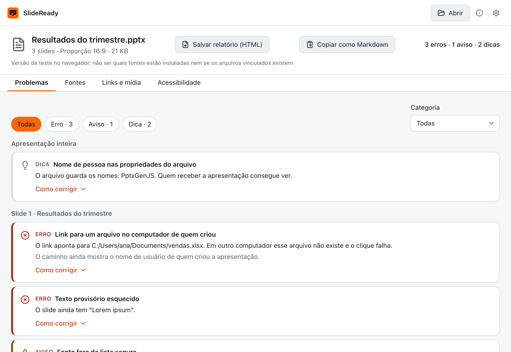

# SlideReady

[Português](README.md)

Check a .pptx before you present: fonts that will change, links to local files, media that will not travel and forgotten placeholder text, slide by slide.

<!-- Record docs/demo.gif and uncomment the line below. -->
<!--  -->

| Light                                                              | Dark                                                             |
| ------------------------------------------------------------------ | ---------------------------------------------------------------- |
|  |  |

## Why it exists

Minutes before presenting, the file opens on another computer and the font changed, the video will not play, the link points to the author's desktop and a "Lorem ipsum" is left on slide 12. SlideReady is the check before you step on stage.

## Download

Get the installer from the [Releases](../../releases) page:

- **macOS:** `SlideReady_x.y.z_universal.dmg`
- **Windows:** `SlideReady_x.y.z_x64-setup.exe`

## First launch

The app is not signed with a paid certificate because it is a free personal project, so the system shows a warning the first time.

**macOS:** open the `.dmg`, drag SlideReady to Applications and open it. If the system blocks it, go to System Settings → Privacy & Security and click "Open Anyway". If you see "is damaged", run this in Terminal:

```sh
xattr -cr /Applications/SlideReady.app
```

**Windows:** the installer does not ask for administrator rights. If SmartScreen shows up, click "More info" and then "Run anyway".

## How to use

1. Drop the `.pptx` on the window (from PowerPoint, Keynote or exported from Google Slides) or click Open.
2. Read the summary at the top: errors, warnings and tips.
3. In the Issues tab, filter by severity or category. Each item shows the slide, an explanation and "How to fix" for PowerPoint on Windows, on Mac and in Google Slides.
4. In the Fonts tab, see which fonts the file uses and whether each will change.
5. "Copy as Markdown" takes the report to an e-mail or chat.

## What it does and does not do

It reads the file in the real slide order, follows layout, master and theme to find the effective text size and font, and applies 20 rules: links to local files, invalid URLs and jumps to missing slides; linked, missing, risky-format or heavy media; fonts that are not embedded and not installed or outside the safe list; placeholder text, small text, text shrunk by autofit and dense slides; images without alt text, slides without a title or with a repeated one, tables without a header; hidden slides, comments and 4:3. The file is never changed.

It does not:

- Render the slides: it estimates sizes and colors inherited from layout, master and theme and, when it cannot resolve one safely, reports nothing. It can miss problems.
- Check color contrast or links on the internet yet.
- In the browser demo it cannot tell which fonts are installed or whether linked files exist.

## Privacy

Nothing leaves your computer. The analysis is local, the app makes no network connections and the file is opened read-only.

## Run locally

Requirements: Node.js LTS, pnpm, Rust (stable) and, on macOS, the Xcode Command Line Tools.

```sh
pnpm install
pnpm tauri dev
pnpm test
```

## Roadmap

- Contrast check (WCAG).
- Optional check of links on the internet.
- Self-contained HTML report and automatic re-analysis when the file is saved.
- Personal metadata and off-slide shapes.
- Web version on GitHub Pages and an `npx slideready check` CLI.

## Contributing

See [CONTRIBUTING.md](CONTRIBUTING.md).

## License

[MIT](LICENSE)
