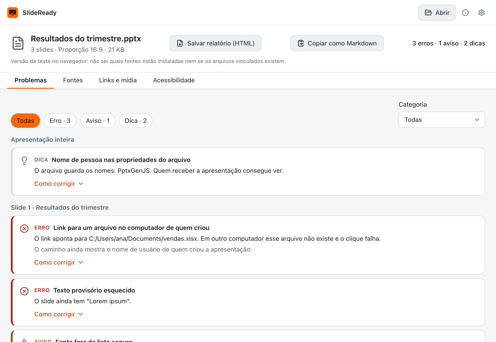
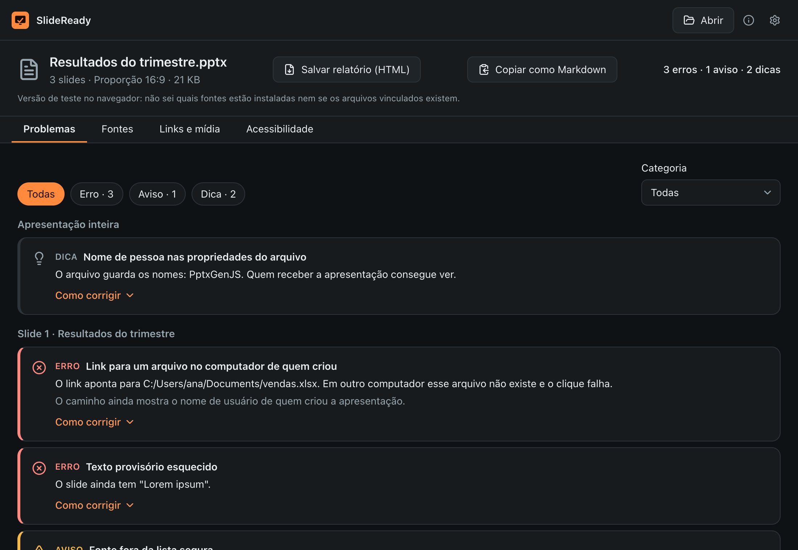

# SlideReady

[English](README.en.md)

Confira um .pptx antes de apresentar: fontes que vão trocar, links para arquivos locais, mídia que não vai junto e texto provisório esquecido, slide por slide.

<!-- Grave docs/demo.gif e descomente a linha abaixo. -->
<!--  -->

| Claro                                                                  | Escuro                                                                 |
| ---------------------------------------------------------------------- | ---------------------------------------------------------------------- |
|  |  |

## Por que existe

Minutos antes de apresentar, o arquivo abre em outro computador e a fonte trocou, o vídeo não toca, o link aponta para a área de trabalho de quem fez e sobrou um "Lorem ipsum" no slide 12. O SlideReady é a checagem antes de subir no palco.

## Download

Baixe o instalador na página de [Releases](../../releases):

- **macOS:** `SlideReady_x.y.z_universal.dmg`
- **Windows:** `SlideReady_x.y.z_x64-setup.exe`

## Primeira abertura

O app não é assinado com certificado pago, porque é um projeto pessoal e gratuito. Por isso o sistema mostra um aviso na primeira vez.

**macOS:** abra o `.dmg`, arraste o SlideReady para Aplicativos e abra. Se o sistema bloquear, vá em Ajustes do Sistema → Privacidade e Segurança e clique em "Abrir Mesmo Assim". Se aparecer a mensagem "está danificado", rode no Terminal:

```sh
xattr -cr /Applications/SlideReady.app
```

**Windows:** o instalador não pede administrador. Se o SmartScreen aparecer, clique em "Mais informações" e depois em "Executar assim mesmo".

## Como usar

1. Arraste o `.pptx` para a janela (do PowerPoint, do Keynote ou do Google Slides exportado) ou clique em Abrir.
2. Veja o resumo no topo: erros, avisos e dicas.
3. Na aba Problemas, filtre por gravidade ou categoria. Cada item mostra o slide, a explicação e "Como corrigir" para PowerPoint no Windows, no Mac e no Google Slides.
4. Na aba Fontes, veja quais fontes o arquivo usa e se cada uma vai trocar.
5. "Copiar como Markdown" leva o relatório para um e-mail ou chat.

## O que ele faz e o que não faz

Faz: lê o arquivo na ordem real dos slides, segue layout, master e tema para achar o tamanho e a fonte efetivos do texto, e aplica 20 regras: links para arquivos locais, URLs inválidas e saltos para slides inexistentes; mídia vinculada, ausente, em formato arriscado ou pesada; fontes não incorporadas e não instaladas ou fora da lista segura; texto provisório, texto pequeno, texto encolhido pelo ajuste automático e slides densos; imagens sem texto alternativo, slides sem título ou com título repetido, tabelas sem cabeçalho; slides ocultos, comentários e proporção 4:3. O arquivo nunca é alterado.

Não faz:

- Não renderiza os slides: estima tamanhos e cores herdados de layout, master e tema e, quando não consegue resolver com segurança, não acusa nada. Pode deixar passar problemas.
- Não verifica contraste de cor nem links na internet ainda.
- Na versão web de teste não dá para saber quais fontes estão instaladas nem se arquivos vinculados existem.

## Privacidade

Nada sai do computador. A análise é local, o app não faz conexões de rede e o arquivo é aberto só para leitura.

## Rodar localmente

Pré-requisitos: Node.js LTS, pnpm, Rust (stable) e, no macOS, as Xcode Command Line Tools.

```sh
pnpm install
pnpm tauri dev
pnpm test
```

## Roadmap

- Verificação de contraste (WCAG).
- Verificação opcional de links na internet.
- Relatório em HTML autocontido e reanálise automática quando o arquivo é salvo.
- Metadados pessoais e elementos fora do slide.
- Versão web em GitHub Pages e CLI `npx slideready check`.

## Contribuir

Veja o [CONTRIBUTING.md](CONTRIBUTING.md).

## Licença

[MIT](LICENSE)
