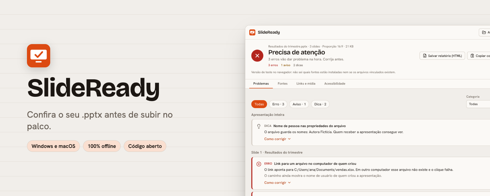

<p align="center">
  
</p>

<p align="center"><a href="README.en.md">English</a> · <a href="../../releases">Download</a></p>

<p align="center">   </p>

Confira um .pptx antes de apresentar: fontes que vão trocar, links para arquivos locais, mídia que não vai junto e texto provisório esquecido, slide por slide.


| Claro                                                                  | Escuro                                                                 |
| ---------------------------------------------------------------------- | ---------------------------------------------------------------------- |
|  |  |

## Como funciona

<p align="center">
  
</p>

## Destaques

- **Uma frase no topo:** "Pronto para apresentar", "Quase lá" ou "Precisa de atenção".
- **27 checagens** de fontes, links, mídia, texto, contraste, acessibilidade e higiene do arquivo, cada uma com "Como corrigir" para PowerPoint no Windows, no Mac e no Google Slides.
- **Reanálise ao salvar:** edite no PowerPoint e veja quantos problemas sumiram.
- **Relatório em HTML** para mandar a quem vai corrigir, e uma **CLI** para rodar a mesma análise no terminal.
- **Nunca altera o arquivo**, e a única coisa que usa a internet é o botão de verificar links.

## Por que existe

Minutos antes de apresentar, o arquivo abre em outro computador e a fonte trocou, o vídeo não toca, o link aponta para a área de trabalho de quem fez e sobrou um "Lorem ipsum" no slide 12. O SlideReady é a checagem antes de subir no palco.

## Instalar pelo Homebrew (macOS)

```sh
brew install --cask yanmfs/tap/slideready
```

O Homebrew baixa o mesmo instalador da release e coloca o SlideReady em Aplicativos. É a versão universal, para Apple Silicon e Intel. Para atualizar, rode `brew update` e `brew upgrade --cask yanmfs/tap/slideready`.

Se o macOS pedir confirmação na primeira abertura, veja a seção **Primeira abertura** abaixo. Mais detalhes em [instalação pelo Homebrew](docs/instalacao-homebrew.md).

## Download

Baixe o instalador na página de [Releases](../../releases):

- **macOS:** `SlideReady_x.y.z_universal.dmg`
- **Windows:** `SlideReady_x.y.z_x64-setup.exe`

Teste no navegador, sem instalar nada: <https://yanmfs.github.io/SlideReady/>. A versão web não sabe quais fontes estão instaladas, não vê arquivos vinculados e não verifica links na internet; o resto da análise é igual.

## Primeira abertura

O app não é assinado com certificado pago, porque é um projeto pessoal e gratuito. Por isso o sistema mostra um aviso na primeira vez.

**macOS:** abra o `.dmg`, arraste o SlideReady para Aplicativos e abra. Se o sistema bloquear, vá em Ajustes do Sistema → Privacidade e Segurança e clique em "Abrir Mesmo Assim". Se aparecer a mensagem "está danificado", rode no Terminal:

```sh
xattr -cr /Applications/SlideReady.app
```

**Windows:** o instalador não pede administrador. Se o SmartScreen aparecer, clique em "Mais informações" e depois em "Executar assim mesmo".

## Como usar

1. Arraste o `.pptx` para a janela (do PowerPoint, do Keynote ou do Google Slides exportado) ou clique em Abrir.
2. O topo diz em uma frase se está tudo certo ("Pronto para apresentar", "Quase lá" ou "Precisa de atenção") e quantos erros, avisos e dicas há.
3. Na aba Problemas, filtre por gravidade ou categoria. Cada item mostra o slide, a explicação e "Como corrigir" para PowerPoint no Windows, no Mac e no Google Slides.
4. Na aba Fontes, veja quais fontes o arquivo usa e se cada uma vai trocar. A aba Links e mídia lista todos os links e arquivos de mídia, e a aba Acessibilidade resume imagens sem descrição, slides sem título e tabelas.
5. "Salvar relatório (HTML)" gera um arquivo único para mandar a quem vai corrigir, e "Copiar como Markdown" leva o relatório para um e-mail ou chat.
6. Se você salvar o arquivo no PowerPoint com o SlideReady aberto, a análise é refeita sozinha e o topo mostra quantos problemas foram resolvidos e quantos são novos.

Opcional: o botão "Verificar links na internet" (aba Links e mídia) testa os endereços da apresentação. É a única ação do app que usa a internet e só roda quando você clica.

No terminal, a mesma análise roda sem interface: `pnpm build:cli` e depois `node dist-cli/slideready.mjs check apresentacao.pptx --json`. O código de saída é 1 quando há erro (ou aviso, com `--fail-on warning`).

## O que ele faz e o que não faz

Faz: lê o arquivo na ordem real dos slides, segue layout, master e tema para achar o tamanho e a fonte efetivos do texto, e aplica 27 regras: links para arquivos locais, URLs inválidas e saltos para slides inexistentes; mídia vinculada, ausente, em formato arriscado ou pesada; fontes não incorporadas e não instaladas ou fora da lista segura; texto provisório, texto pequeno, texto encolhido pelo ajuste automático e slides densos; imagens sem texto alternativo, slides sem título ou com título repetido, tabelas sem cabeçalho; texto com pouco contraste (WCAG); slides vazios, títulos longos demais, fontes demais; slides ocultos, comentários, anotações do orador com texto provisório, nomes de pessoas nas propriedades do arquivo, objetos fora da área do slide e proporção 4:3. O arquivo nunca é alterado.

Não faz:

- Não renderiza os slides: estima tamanhos e cores herdados de layout, master e tema e, quando não consegue resolver com segurança, não acusa nada. Pode deixar passar problemas.
- O contraste só é medido quando o texto e o fundo são cores simples (sem gradiente, imagem ou transformação de cor do tema); nos outros casos não acusa nada. Na verificação de links, sites que recusam testes automáticos aparecem como "não foi possível confirmar", não como quebrados.
- Na versão web de teste não dá para saber quais fontes estão instaladas nem se arquivos vinculados existem.

## Privacidade

Nada sai do computador. A análise é local e o arquivo é aberto só para leitura. A única conexão de rede é a verificação de links, que você pede com um clique; ela roda fora do webview, que continua com as conexões bloqueadas, e envia só os endereços que já estão na apresentação.

## Rodar localmente

Pré-requisitos: Node.js LTS, pnpm, Rust (stable) e, no macOS, as Xcode Command Line Tools.

```sh
pnpm install
pnpm tauri dev
pnpm test
```

## Roadmap

- Contraste de texto sobre gradientes e imagens.
- Publicar a CLI no npm (`npx slideready check`).

## Contribuir

Issues e pull requests são bem-vindos.

## Licença

[MIT](LICENSE)
